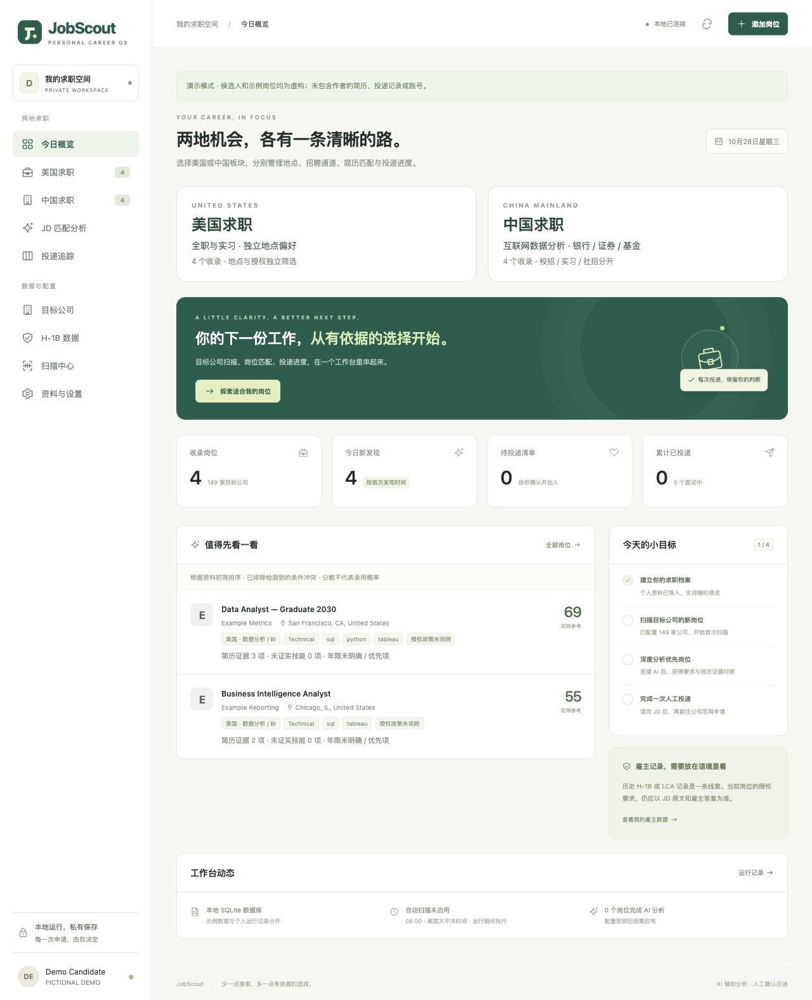
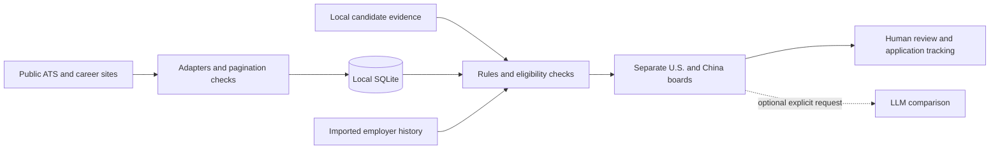

# JobScout — AI-Assisted Job Search Workbench

A local-first web application for collecting jobs, comparing requirements with candidate evidence, and reviewing opportunities across the U.S. and mainland China.

**Public portfolio edition.** All bundled candidate profiles and demo jobs are fictional. Personal résumés, application history, employer correspondence, credentials, collected job databases and browser sessions are excluded.



## Why I built it

Job discovery was fragmented across ATS boards, company career sites and manually saved descriptions. JobScout brings collection, evidence-based screening, deadline checks and application tracking into one workflow, while keeping the final application decision with the user.

This personal project was developed with AI coding assistants, including Claude Code and ChatGPT/Codex, to translate product requirements into a runnable application, iteratively debug integrations, and test the resulting behavior.

## What it does

- **Separate U.S. and China workspaces:** independent location, internship/full-time, experience, skills, recruitment-track and deadline filters.
- **Public-source ingestion:** Greenhouse, Lever and Ashby ATS adapters, plus adapters for selected Chinese employer career sites. The bundled registry contains 149 ATS company configurations and 35 China-source configurations; it is configuration, not a promise that every endpoint is currently available.
- **Evidence-based screening:** distinguish explicit conflicts, unverified requirements, demonstrated skills and gaps. Graduation month and internship-location preferences are configurable locally.
- **Employer history:** import U.S. Department of Labor LCA and USCIS employer-level CSV/XLSX records. Historical filings are contextual evidence, not confirmation that a current role offers sponsorship.
- **Optional LLM analysis:** an explicitly triggered Anthropic API call can compare a JD with the local candidate profile. The core application and rule-based screening do not require an API key.
- **Review and tracking:** save notes, shortlist jobs, record application stages and export results. The application does not auto-submit job applications.
- **Source accountability:** display failed, manual and partial sources separately. Incomplete feeds do not automatically close unseen jobs; browser snapshots retain their original verification time.

## Run the fictional demo

Requires **Python 3.11+**. The core server uses the Python standard library.

```bash
python3 scripts/setup_demo.py
python3 server.py --no-scheduler
```

Open **http://127.0.0.1:8765/**. The demo creates eight fictional jobs and two fictional candidate profiles locally. It makes no employer or AI requests during setup, and scheduled scanning is disabled by default.

If that port is occupied:

```bash
python3 server.py --port 8766 --no-scheduler
```

Optional XLSX import support:

```bash
python3 -m pip install -r requirements.txt
```

The demo setup refuses to insert sample jobs into an already populated database. For a separate demo, use a fresh checkout.

## Use your own local data

1. Start the server once to create local files.
2. Edit candidate evidence in **资料与设置 / Settings**. English and Chinese profiles are separate.
3. Edit `data/candidate.json` to set graduation month, degree and internship preferences. The committed `config/candidate.example.json` is fictional.
4. Review `config/companies.toml` and `config/china_sources.json` before starting live collection.
5. Trigger scans in the UI, or run `python3 scripts/scan_us.py` / `python3 scripts/scan_china.py`.
6. Enable daily scanning only if desired. The scheduler runs while the local server and computer are running; it is not an always-on cloud service.

To activate optional AI analysis, supply your own API key through Settings or `ANTHROPIC_API_KEY`, and configure an available model ID. **AI analysis sends the selected JD and candidate profile to Anthropic.** Rules-only use does not send profiles to an AI provider. Never commit local API keys.

## Architecture



| Component | Implementation |
|---|---|
| Interface | HTML, CSS and vanilla JavaScript |
| Local API | Python `ThreadingHTTPServer`, loopback-only binding, request-token and origin checks |
| Persistence | SQLite jobs, scores, notes, stages and scan history |
| Collection | Public ATS APIs and employer-specific adapters with deduplication and pagination validation |
| Analysis | Auditable rules; optional Anthropic API analysis |
| Testing | Python unit/integration tests, Node reconnection test and privacy audit |

## Verification

The regression suite uses a **fictional 2027-05 test fixture**, independently of the 2030-06 demo candidate:

```bash
python3 scripts/setup_demo.py
JOBSCOUT_GRADUATION_MONTH=2027-05 python3 -m unittest discover -s tests -p 'test_*.py'
node --check web/app.js
node tests/test_reconnect.cjs
python3 scripts/privacy_check.py
```

Tests cover imports, request validation, persistence, incomplete-feed behavior, duplicate pagination, experience and graduation conflicts, date provenance, source-specific job types, and reconnection.

## Scope and limitations

This is a personal decision-support project, not a production recruitment service. Public endpoints can change or reject requests. Missing jobs do not prove a vacancy has closed. Matching scores are heuristic references, not hiring predictions. Unknown requirements remain unverified, and technical research roles are separated as stretch opportunities.

The public package includes **no live collected JD corpus or application history**. The ByteDance browser adapter can read a locally supplied complete-JD snapshot, but is disabled in the public configuration because no personal browser data is distributed. Screenshots show fictional demo data only.

See [privacy and publication boundaries](docs/PRIVACY.md) and [design decisions](docs/DESIGN.md).
